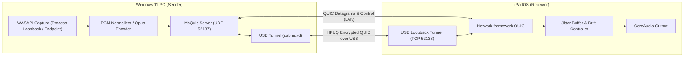

<div align="center">
  <picture>
    <source media="(prefers-color-scheme: dark)" srcset="ios/HearPortApp/Resources/Assets.xcassets/HearPortSymbol.imageset/HearPortSymbol-Dark.png" />
    <source media="(prefers-color-scheme: light)" srcset="ios/HearPortApp/Resources/Assets.xcassets/HearPortSymbol.imageset/HearPortSymbol-Light.png" />
    
  </picture>

  <h1>HearPort</h1>

  <p>
    <strong>Stream Windows PC audio to your iPad over Wi-Fi or USB — low-latency, encrypted, and open source.</strong>
  </p>

  <p>
    <a href="https://github.com/lsy223622/HearPort/actions/workflows/windows-release.yml">
      
    </a>
    <a href="https://github.com/lsy223622/HearPort/actions/workflows/ios-receiver.yml">
      
    </a>
    <a href="LICENSE">
      
    </a>
    
    
  </p>

  <p>
    <a href="#features">Features</a> ·
    <a href="#quick-start">Quick Start</a> ·
    <a href="#how-it-works">How It Works</a> ·
    <a href="#local-development-verification">Building from Source</a> ·
    <a href="#documentation">Docs</a>
  </p>

  <p>
    <strong>English</strong> | <a href="README.zh-CN.md">简体中文</a>
  </p>
</div>

HearPort turns your iPad into a low-latency wireless or wired audio output for your Windows 11 PC. Pair once, stream over your local network or a USB cable with automatic route switching, and keep everything offline with zero cloud accounts or telemetry.

## Features

- **Automatic LAN ↔ USB Handover**: Streams over your local network by default. Plug in a USB data cable and HearPort automatically upgrades to USB, then falls back to your remembered LAN route when unplugged.
- **Per-Route Codec & Delay Profiles**: Keep independent settings for **Network audio** (defaults to Opus 256 kbps / 5 ms / Datagram) and **USB audio** (defaults to Float32 PCM / 2.5 ms / Reliable), with configurable PCM sample-rate and bit-depth caps on Windows.
- **App-Level Audio Capture**: Uses WASAPI Process Loopback by default (excluding HearPort itself), so muting or lowering your PC speakers does not silence the stream — or switch to the default output device in one click.
- **Private & Encrypted by Default**: Pairs via a 6-digit PIN using RFC 9382 SPAKE2 (P-256) and TLS certificate SPKI pinning. Long-term credentials stay in Windows Credential Manager and iPadOS Keychain.
- **System Tray & iPadOS Integration**: Control your iPad's volume right from the Windows tray (scroll wheel for 5% steps, click speaker to mute), use lock-screen/headphone media controls, and trigger connections via built-in iPadOS App Shortcuts.
- **One-Tap Network Auto-Tuning**: Long-press any PC on iPad to run a quick LAN benchmark tailored to **Low latency**, **Balanced**, or **Stability first**, then apply the recommended settings in one tap.

## Requirements

| Platform | Minimum Requirements | Notes |
| --- | --- | --- |
| **Windows (Sender)** | Windows 11 (x64)<br>[Windows App Runtime 2.6.5 (x64)](https://aka.ms/windowsappsdk/2.6/2.6.5/windowsappruntimeinstall-x64.exe)+ | Distributed as a portable ZIP containing VC runtime and `msquic.dll` — keep all extracted files together. USB mode requires Apple's Windows device support. |
| **iPad (Receiver)** | iPadOS 16.0+<br>*(iPadOS 17.2+ for audio App Shortcuts)* | Distributed as an unsigned `.ipa`. Sign and sideload it using an Apple-compatible signing tool (Xcode, AltStore, SideStore, Sideloadly, etc.). |

## Quick Start

1. **Get the apps**  
   Download a matched pair (`HearPort-*-windows-x64.zip` and `HearPort-*-unsigned.ipa`) from [GitHub Releases](https://github.com/lsy223622/HearPort/releases), or pull `HearPort-windows-release` and `HearPort-unsigned-ipa` from the **same commit** in [GitHub Actions](https://github.com/lsy223622/HearPort/actions). Extract the Windows ZIP into a folder and keep all files together, then sign and install the IPA on your iPad.

2. **Launch & discover**  
   Run `HearPort.exe` on Windows and open **HearPort** on your iPad. Your PC appears automatically via local DNS-SD (`_hearport._udp`). If auto-discovery is unavailable, enter the PC's hostname or IP address manually.

3. **Pair once**  
   On the Windows **Overview** tab, click **Pair new iPad** to generate a temporary 6-digit PIN. On your iPad, tap **Pair and remember** and enter the PIN. Pairing works over either LAN or USB.

4. **Start streaming (LAN or USB)**  
   Tap your paired PC on iPad to connect. For USB audio, install Apple's Windows device support, connect a data cable, unlock your iPad, and tap **Trust** if prompted — **Automatic** mode prefers USB whenever it is ready and returns to LAN when disconnected.

> [!TIP]
> **Firewall & ports:** LAN discovery and audio use **UDP `52137`** by default — allow `HearPort.exe` through Windows Firewall on your local network profile if discovery or connection stalls. USB mode forwards encrypted QUIC packets through Apple's device service over loopback **TCP `52138`**, so it needs no inbound LAN TCP firewall rule. See the [Windows onboarding & firewall guide](https://github.com/lsy223622/HearPort/blob/main/windows/installer/README.md) for details.

## Everyday Usage

- **Windows Tray Controls**: Left-click the tray icon for connection status, sender controls, and a live iPad volume slider (scroll over the slider to step by 5%, or click the speaker icon to mute). Double-click to open **Overview**, or right-click for **Open HearPort** / **Exit**.
- **Auto-Tuning Your Wi-Fi**: Long-press an available PC on the iPad home screen to start **Automatic test and recommendations** (unpaired PCs prompt for a PIN first). Pick **Low latency**, **Balanced**, or **Stability first**. HearPort pauses playback, benchmarks random traffic across Datagram and Reliable QUIC in ABBA order, verifies the winning profile, applies it to **Network audio** only, and reconnects automatically.
- **Unpairing**: Long-press a PC on iPad to forget it, or click **Unpair iPad** on Windows **Overview**. Both delete the local credential and send a best-effort authenticated unpair notice if connected. Explicit authentication rejections stop automatic retries without deleting saved credentials; ordinary network timeouts keep them intact.
- **Keep Screen Awake**: Enabling **Keep screen awake** on iPad keeps the display on while HearPort is in the foreground; automated network tests also keep the screen awake while running.

## How It Works

HearPort runs QUIC over both LAN and USB (`usbmux` loopback forwarding), pairing a local WASAPI capture/encoder pipeline on Windows with a lock-free jitter buffer, clock-drift resampler, and CoreAudio output chain on iPad:



## Advanced Settings & Diagnostics

<details>
<summary><strong>Audio capture modes & PCM format limits</strong></summary>

- **Capture source**: HearPort defaults to **WASAPI Process Loopback** (excluding its own process tree), capturing system-wide app audio across output devices before Windows master volume or mute. If Process Loopback fails to start, it falls back to the default output device. You can switch explicitly via **Settings → Audio capture → Default output device** (or `--capture=process` / `--capture=endpoint` on the CLI sender); changing it restarts the sender.
- **PCM caps**: In Windows **Settings**, **PCM sample rate limit (Hz)** and **PCM bit depth limit** display your default output device's format as placeholders. Leave blank to follow Windows within HearPort's supported range, or enter a value to cap normal PCM output (e.g., capping 48 kHz / 24-bit to 16-bit sends 48 kHz / 16-bit stereo PCM). Opus uses its own settings, and receivers without variable PCM support use 48 kHz / Float32 PCM.

</details>

<details>
<summary><strong>Playback delay budgets</strong></summary>

- iPad **Playback** settings maintain separate **Network audio** and **USB audio** pages for transport mode, codec, normal target delay, and maximum total delay.
- Both routes start with a **50 ms** target and **100 ms** maximum budget (upgrades preserve any previous shared budget for the network route).
- These budgets cover end-to-end playback (transport, processing, and output reserve) rather than measured acoustic latency; the maximum sets how long a transient stall can be absorbed. Changes take effect on the next connection.

</details>

<details>
<summary><strong>Logs, diagnostics & benchmark tools</strong></summary>

- **Local-only storage**: Both endpoints keep ~4 MiB of ordinary runtime logs (1 MiB × 4 files) or ~128 MiB when detailed logging is enabled (16 MiB × 8 files; turning it off prunes older/oversized files). Detailed iPad logs include each auto-tuning observation, and iPad exports stream a fixed-length snapshot including USB listener/forwarder state.
- **Diagnostics panel**: Shows up to 2,000 recent in-memory entries (which does not truncate disk logs or exports) and provides synthetic compression-load tests plus real PCM/Opus music benchmarks from Windows.
- **Privacy note**: Logs and exported diagnostic reports are stored locally only, but can contain local hostnames, IP addresses, and port numbers — review them before sharing publicly.

</details>

## Documentation

| Guide | What it covers |
| --- | --- |
| [Windows Onboarding & Firewall](https://github.com/lsy223622/HearPort/blob/main/windows/installer/README.md) | Portable ZIP setup, USB device support, and Windows Firewall rules |
| [Connection Automation & Shortcuts](https://github.com/lsy223622/HearPort/blob/main/docs/connection-automation.md) | Auto-reconnect rules, built-in iPadOS App Shortcuts, URL kit, and verification matrix |
| [Compression & Music Benchmarks](https://github.com/lsy223622/HearPort/blob/main/docs/compression-tests.md) | Synthetic load & 32-round PCM/Opus music tests and analysis scripts |
| [Wire Protocol](https://github.com/lsy223622/HearPort/blob/main/protocol/README.md) | `hearport-v1.proto`, `HPUQ` USB framing, audio datagrams, and format negotiation |
| [Security Implementation](https://github.com/lsy223622/HearPort/blob/main/docs/security-implementation.md) | RFC 9382 SPAKE2 pairing, TLS SPKI pinning, and Credential Manager / Keychain storage |
| [Local Diagnostics & PLC](https://github.com/lsy223622/HearPort/blob/main/diagnostics/README.md) & [Offline Transport](https://github.com/lsy223622/HearPort/blob/main/diagnostics/offline-transport.md) | JSONL event schemas, offline music concealment (`music_plc.py`), and transport simulations |
| [Validation Matrix](https://github.com/lsy223622/HearPort/blob/main/docs/validation-matrix.md) & [Release Checklist](https://github.com/lsy223622/HearPort/blob/main/docs/release-checklist.md) | Automated, native build, and physical device verification records |

<a id="local-development-verification"></a>
## Building from Source

### Prerequisites (Windows Release Build)

- **Python** 3.11+
- **Rust / Cargo** 1.87+
- **CMake** 3.24+ and a **Visual Studio 2022 x64 Developer Shell** (with VC++ redistributables)
- **vcpkg** with `msquic:x64-windows` installed and `VCPKG_ROOT` pointing to your vcpkg checkout
- **Windows App Runtime 2.6.5 (x64)** and **Windows SDK C++/WinRT** tools
- **`nuget.exe`** on `PATH`

### Build, Test & Package (PowerShell)

```powershell
nuget install Microsoft.Web.WebView2 -Version 1.0.3719.77 -OutputDirectory out/winui -NonInteractive
$webViewMetadata = Get-ChildItem out/winui -Recurse -Filter Microsoft.Web.WebView2.Core.winmd | Select-Object -First 1
./scripts/generate_winui_projection.ps1 -OutputDir "$PWD/out/winui/projection" -WebViewMetadata $webViewMetadata.FullName
python scripts/fetch_opus.py
cmake -S . -B out/build/windows-release -G "Visual Studio 17 2022" -A x64 `
  "-DHEARPORT_WINUI_PROJECTION_DIR=$PWD/out/winui/projection" `
  "-DCMAKE_TOOLCHAIN_FILE=$env:VCPKG_ROOT/scripts/buildsystems/vcpkg.cmake" `
  "-DHEARPORT_MSQUIC_LIBRARY=$env:VCPKG_ROOT/installed/x64-windows/lib/msquic.lib" `
  "-DHEARPORT_MSQUIC_DLL=$env:VCPKG_ROOT/installed/x64-windows/bin/msquic.dll"
cmake --build out/build/windows-release --config Release --parallel 4
ctest --test-dir out/build/windows-release -C Release --output-on-failure
python scripts/collect_notices.py --output-dir out/release-notices `
  --msquic-copyright "$env:VCPKG_ROOT/installed/x64-windows/share/msquic/copyright"
python scripts/package_release.py --build-dir out/build/windows-release --output-dir out/release `
  --notices-dir out/release-notices --runtime-dir "$env:VCToolsRedistDir/x64/Microsoft.VC143.CRT"
```

> [!NOTE]
> Local packages are for development verification and require a clean committed working tree. To distribute a matched pair, trigger both **Windows Release package** and **iOS receiver package tests** in GitHub Actions on the same commit (or pass `--ipa <path-to-ipa>` from that exact commit's workflow output to `scripts/package_release.py`). `package_release.py` emits a portable Windows ZIP, source archive, and `SHA256SUMS.txt`, rejecting Debug runtimes, missing DLLs, version mismatches, or non-empty target files.

## License

HearPort is licensed under the [GNU General Public License v3.0](LICENSE). See [THIRD_PARTY_NOTICES.md](THIRD_PARTY_NOTICES.md) for bundled third-party components (including Opus 1.6.1, MsQuic, and the Rust SPAKE2 provider dependencies).
