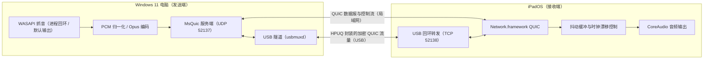

<div align="center">
  <picture>
    <source media="(prefers-color-scheme: dark)" srcset="ios/HearPortApp/Resources/Assets.xcassets/HearPortSymbol.imageset/HearPortSymbol-Dark.png" />
    <source media="(prefers-color-scheme: light)" srcset="ios/HearPortApp/Resources/Assets.xcassets/HearPortSymbol.imageset/HearPortSymbol-Light.png" />
    
  </picture>

  <h1>HearPort</h1>

  <p>
    <strong>把 Windows 电脑的声音低延迟传到 iPad —— 支持 Wi-Fi 与 USB 有线直连，全程本地加密，开源免费。</strong>
  </p>

  <p>
    <a href="https://github.com/lsy223622/HearPort/actions/workflows/windows-release.yml">
      
    </a>
    <a href="https://github.com/lsy223622/HearPort/actions/workflows/ios-receiver.yml">
      
    </a>
    <a href="LICENSE">
      
    </a>
    
    
  </p>

  <p>
    <a href="#功能特性">功能特性</a> ·
    <a href="#快速上手">快速上手</a> ·
    <a href="#工作原理">工作原理</a> ·
    <a href="#从源码构建">从源码构建</a> ·
    <a href="#相关文档">相关文档</a>
  </p>

  <p>
    <a href="README.md">English</a> | <strong>简体中文</strong>
  </p>
</div>

HearPort 可以把 iPad 变成 Windows 11 电脑的低延迟无线或有线音频输出设备。配对一次之后，日常在局域网和 USB 数据线之间自动无感切换；所有连接与音频流均在本地完成，不需要任何云端账号，也没有遥测上报。

## 功能特性

- **Wi-Fi 与 USB 自动切换**：默认通过局域网传输；插上 USB 数据线并完成信任后会自动切到 USB 通道，拔线后再自动切回已记住的局域网连接。
- **双路线独立编码与延迟预算**：**网络音频**（默认 Opus 256 kbps / 5 ms / Datagram）与 **USB 音频**（默认 Float32 PCM / 2.5 ms / Reliable）各自保存独立的传输方式、编码和延迟设置；Windows 端还支持限制 PCM 采样率与位深。
- **按进程抓音，不怕误静音**：默认使用 WASAPI Process Loopback 抓取应用声音（自动排除 HearPort 自身），调低或静音电脑扬声器也不影响 iPad 播放；也可一键改为抓取默认输出设备。
- **本地加密与设备绑定**：通过 6 位一次性 PIN 码完成 RFC 9382 SPAKE2（P-256）认证并固定 TLS 证书 SPKI 指纹，长期凭据保存在 Windows 凭据管理器与 iPadOS 钥匙串中。
- **桌面托盘与系统集成**：在 Windows 托盘即可查看状态并直接调节 iPad 音量（滚轮每格 5%、点击喇叭静音）；iPad 端支持锁屏/耳机媒体按键控制，并内置 iPadOS App Shortcuts 快捷指令动作。
- **一键网络测速调优**：在 iPad 首页长按电脑即可针对「低延迟 / 均衡 / 稳定优先」跑一轮局域网压测，一键应用推荐参数。

## 运行环境

| 端 | 最低要求 | 说明 |
| --- | --- | --- |
| **Windows 发送端** | Windows 11 (x64)<br>[Windows App Runtime 2.6.5 (x64)](https://aka.ms/windowsappsdk/2.6/2.6.5/windowsappruntimeinstall-x64.exe) 或更高版本 | 以绿色便携 ZIP 分发，内含 VC 运行库与 `msquic.dll`，解压后请保持目录内文件完整。使用 USB 模式需提前安装 Apple 的 Windows 设备支持（iTunes / Apple Devices）。 |
| **iPad 接收端** | iPadOS 16.0+<br>*（音频类快捷指令需 iPadOS 17.2+）* | 以未签名 `.ipa` 分发，需自行使用 Xcode、AltStore、SideStore、Sideloadly 等工具签名安装。 |

## 快速上手

1. **下载两端程序**  
   推荐从 [GitHub Releases](https://github.com/lsy223622/HearPort/releases) 下载配套的双端安装包（`HearPort-*-windows-x64.zip` 与 `HearPort-*-unsigned.ipa`），或在 [GitHub Actions](https://github.com/lsy223622/HearPort/actions) 中从**同一个 commit** 下载 `HearPort-windows-release` 与 `HearPort-unsigned-ipa`。将 Windows 压缩包解压到同一文件夹并保持文件完整，再把 IPA 签名安装到 iPad。

2. **启动并发现设备**  
   在电脑上运行 `HearPort.exe`，同时打开 iPad 上的 **HearPort**。局域网内会通过 DNS-SD（`_hearport._udp`）自动发现电脑；如果没搜到，也可以在连接设置中手动输入主机名或 IP 地址。

3. **首次配对**  
   在 Windows 端的**概览（Overview）**页点击**配对新 iPad（Pair new iPad）**生成临时 6 位 PIN 码；在 iPad 端选择**配对并记住（Pair and remember）**并输入该 PIN 码（局域网或 USB 下均可完成配对）。

4. **开始播放（Wi-Fi 或 USB）**  
   配对完成后点击电脑即可开始推流。如需走有线传输，请安装 Apple 的 Windows 设备支持组件，用数据线连接 iPad、解锁屏幕并点按“信任此电脑”——**自动模式**会在 USB 就绪时优先走 USB，断开后自动切回 Wi-Fi。

> [!TIP]
> **防火墙与端口说明：** 局域网发现和音频默认使用 **UDP `52137`** 端口，如被拦截请在 Windows 防火墙中放行 `HearPort.exe` 的本地网络流量。USB 模式通过 Apple 设备服务经本机回环 **TCP `52138`** 转发加密的 QUIC 数据包，无需在局域网开放额外 TCP 入站规则。更多排查步骤见 [Windows 上手与防火墙指南](https://github.com/lsy223622/HearPort/blob/main/windows/installer/README.md)。

## 日常使用

- **Windows 托盘控制**：左键点击托盘图标可快速启停推流、查看连接状态并拖动 iPad 音量条（鼠标滚轮按 5% 步进调节，点击喇叭切换静音）；双击直达**概览**页，右键打开完整菜单。
- **自动测速调优**：在 iPad 首页长按可用电脑即可发起**自动测试与推荐**（未配对会先提示输入 PIN），按需选择「低延迟」「均衡」或「稳定优先」。测试会短暂暂停当前播放，在局域网内按 ABBA 顺序对比 Datagram / Reliable QUIC 及编码预算，验证完成后仅更新**网络音频**配置并自动恢复播放。
- **取消配对**：在 iPad 上长按电脑移除配对，或在 Windows **概览**页点击**取消配对 iPad**。两头都会删除本地凭据；处于连接状态时还会向对端发送一条经过认证的解除通知。遇到明确认证拒绝时会自动停止后台重试但保留凭据（不会因临时断网或超时误删配对）。
- **保持屏幕常亮**：在 iPad 设置中开启**保持屏幕常亮**后，应用处于前台期间不会自动锁屏；自动网络测试运行期间也会保持常亮。

## 工作原理

HearPort 在局域网和 USB（`usbmux` 回环转发）两条物理通路上统一承载 QUIC 传输：Windows 端负责 WASAPI 抓音与编码推流，iPad 端通过无锁环形缓冲、抖动缓冲和时钟漂移重采样直接送入 CoreAudio 输出：



## 进阶设置与诊断

<details>
<summary><strong>抓音模式与 PCM 格式上限</strong></summary>

- **抓音来源**：默认使用 **WASAPI Process Loopback**（自动排除 HearPort 自身进程树），在系统总音量和静音控制之前抓取全系统应用混音；若环境不支持会回退到 Windows 默认输出设备。可在**设置 → 音频捕获 → 默认输出设备**手动切换（命令行发送端对应 `--capture=process` 或 `--capture=endpoint`），切换会重启发送服务。
- **PCM 上限**：Windows **设置**中的 **PCM 采样率上限（Hz）** 与 **PCM 位深上限** 默认以当前输出设备格式作为占位提示。留空表示在 HearPort 支持范围内跟随系统；填入数值则用于限制普通 PCM 播放上限（例如系统为 48 kHz / 24-bit 时限制 16-bit，将发送 48 kHz / 16-bit 立体声 PCM）。Opus 使用各自独立的配置；不支持可变 PCM 的接收端固定使用 48 kHz / Float32。

</details>

<details>
<summary><strong>播放延迟预算说明</strong></summary>

- iPad 端**播放设置**分别为**网络音频**和**USB 音频**保存传输方式、编码格式、常规目标延迟和最大总延迟。
- 两条路线初始均为 **50 ms** 目标延迟与 **100 ms** 最大延迟（从旧版升级时会保留此前共用的预算到网络路线）。
- 这些数值代表从传输、编解码处理到输出缓冲的端到端总预算，而非实测声学延迟；最大延迟决定了能容忍多少毫秒的短时卡顿。修改后将在下次建立连接时生效。

</details>

<details>
<summary><strong>本地日志、隐私与对比基准测试</strong></summary>

- **纯本地留存**：两端普通模式各保留约 4 MiB 循环日志（1 MiB × 4 个文件）；开启详细日志后扩容至约 128 MiB（16 MiB × 8 个文件），关闭后自动清理旧文件和超限文件。iPad 开启详细日志时会记录每轮自动调优的观测参数，导出时会在后台流式打包定长快照及当前 USB 监听/转发状态。
- **诊断面板**：页面内展示最近 2,000 条内存日志预览（不会截断磁盘日志或导出文件），并可在 Windows **诊断**页发起合成压缩负载测试与 32 组真实 PCM/Opus 音乐对比测试。
- **隐私提示**：所有诊断文件均保存在本地，但日志和导出报告可能包含局域网主机名、IP 地址与端口号，对外分享前请先检查脱敏。

</details>

## 相关文档

| 文档 | 内容说明 |
| --- | --- |
| [Windows 上手与防火墙指南](https://github.com/lsy223622/HearPort/blob/main/windows/installer/README.md) | 便携版目录说明、Apple USB 驱动与 Windows 防火墙配置 |
| [自动连接与 iPad 快捷指令](https://github.com/lsy223622/HearPort/blob/main/docs/connection-automation.md) | 自动重连机制、内置 iPadOS 快捷动作、URL 启动包与真机验证清单 |
| [压缩与传输对比测试](https://github.com/lsy223622/HearPort/blob/main/docs/compression-tests.md) | 合成负载与 32 组 PCM/Opus 音乐实测矩阵及分析脚本 |
| [Wire 协议说明](https://github.com/lsy223622/HearPort/blob/main/protocol/README.md) | `hearport-v1.proto`、USB `HPUQ` 帧格式、音频报文与格式协商 |
| [安全实现说明](https://github.com/lsy223622/HearPort/blob/main/docs/security-implementation.md) | RFC 9382 SPAKE2 配对、TLS SPKI 固定及凭据安全存储边界 |
| [本地诊断与 PLC](https://github.com/lsy223622/HearPort/blob/main/diagnostics/README.md) · [离线传输模拟](https://github.com/lsy223622/HearPort/blob/main/diagnostics/offline-transport.md) | JSONL 事件格式规范、离线丢包隐藏（`music_plc.py`）与传输仿真实验 |
| [验证矩阵](https://github.com/lsy223622/HearPort/blob/main/docs/validation-matrix.md) 与 [发布检查清单](https://github.com/lsy223622/HearPort/blob/main/docs/release-checklist.md) | 自动化测试、原生构建及真机实测记录 |

<a id="local-development-verification"></a>
## 从源码构建

### 构建前置要求（Windows Release）

- **Python** 3.11+
- **Rust / Cargo** 1.87+
- **CMake** 3.24+ 与 **Visual Studio 2022 x64 开发者命令行**（含 VC++ 可再发行组件）
- **vcpkg**：已安装 `msquic:x64-windows`，且设置好 `VCPKG_ROOT` 环境变量
- **Windows App Runtime 2.6.5 (x64)** 与 **Windows SDK C++/WinRT** 工具
- **`nuget.exe`**（位于 `PATH` 中）

### 编译、测试与打包（PowerShell）

```powershell
nuget install Microsoft.Web.WebView2 -Version 1.0.3719.77 -OutputDirectory out/winui -NonInteractive
$webViewMetadata = Get-ChildItem out/winui -Recurse -Filter Microsoft.Web.WebView2.Core.winmd | Select-Object -First 1
./scripts/generate_winui_projection.ps1 -OutputDir "$PWD/out/winui/projection" -WebViewMetadata $webViewMetadata.FullName
python scripts/fetch_opus.py
cmake -S . -B out/build/windows-release -G "Visual Studio 17 2022" -A x64 `
  "-DHEARPORT_WINUI_PROJECTION_DIR=$PWD/out/winui/projection" `
  "-DCMAKE_TOOLCHAIN_FILE=$env:VCPKG_ROOT/scripts/buildsystems/vcpkg.cmake" `
  "-DHEARPORT_MSQUIC_LIBRARY=$env:VCPKG_ROOT/installed/x64-windows/lib/msquic.lib" `
  "-DHEARPORT_MSQUIC_DLL=$env:VCPKG_ROOT/installed/x64-windows/bin/msquic.dll"
cmake --build out/build/windows-release --config Release --parallel 4
ctest --test-dir out/build/windows-release -C Release --output-on-failure
python scripts/collect_notices.py --output-dir out/release-notices `
  --msquic-copyright "$env:VCPKG_ROOT/installed/x64-windows/share/msquic/copyright"
python scripts/package_release.py --build-dir out/build/windows-release --output-dir out/release `
  --notices-dir out/release-notices --runtime-dir "$env:VCToolsRedistDir/x64/Microsoft.VC143.CRT"
```

> [!NOTE]
> 本地构建包仅用于开发验证，打包前需确保 Git 工作区已提交干净。正式分发时，请在同一个 commit 上触发 GitHub Actions 中的 **Windows Release package** 与 **iOS receiver package tests**（或向 `scripts/package_release.py` 传入同一 commit 的 `--ipa <ipa路径>`）。打包脚本会生成 Windows 便携压缩包、源码归档与 `SHA256SUMS.txt`，若检测到 Debug 运行库、缺失 DLL、版本不一致或目标目录已有残留文件则会直接拦截报错。

## 开源许可

HearPort 基于 [GNU General Public License v3.0](LICENSE) 开源。内置第三方组件（Opus 1.6.1、MsQuic 及 Rust SPAKE2 依赖）的版权与许可声明见 [THIRD_PARTY_NOTICES.md](THIRD_PARTY_NOTICES.md)。
